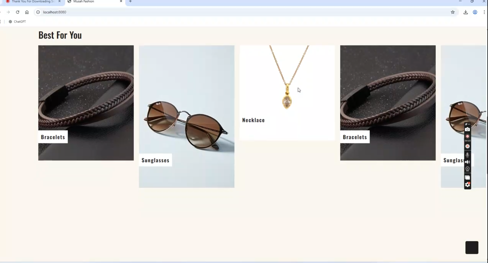
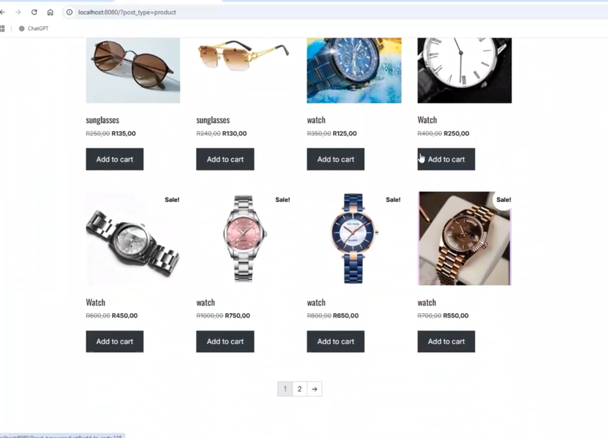
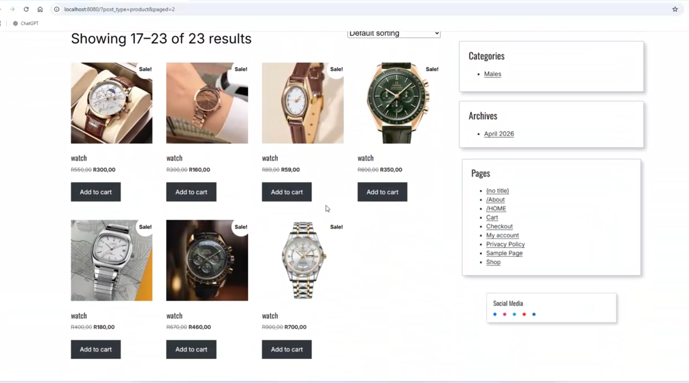
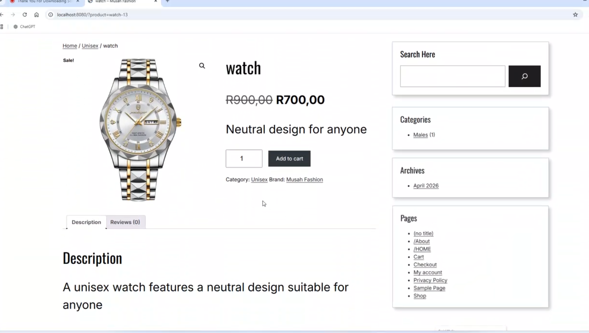
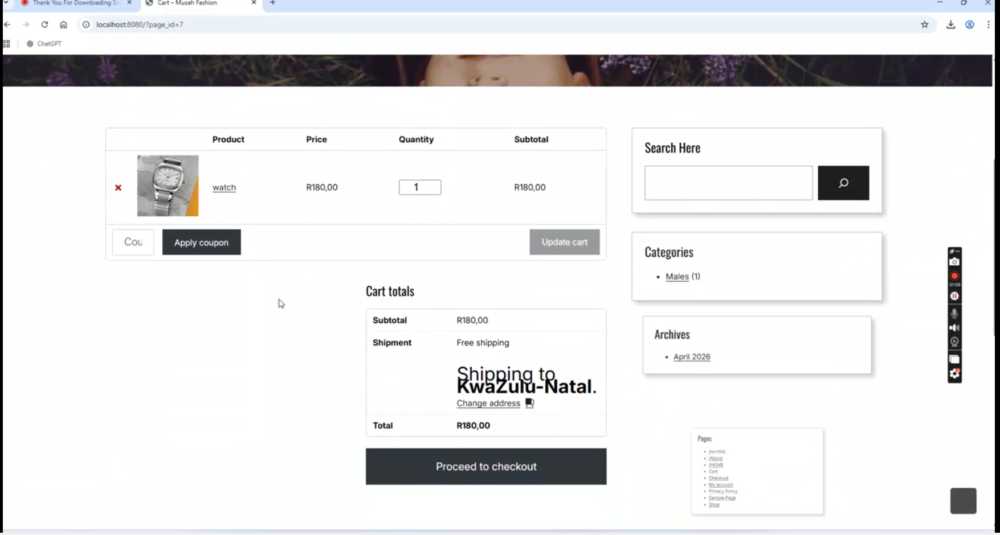
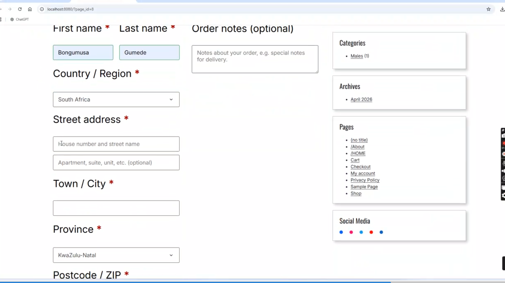
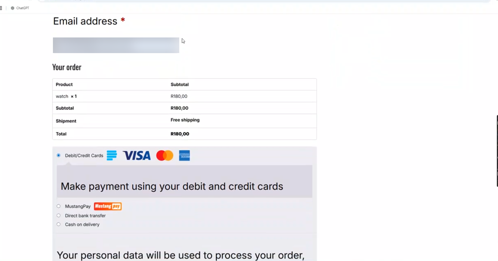
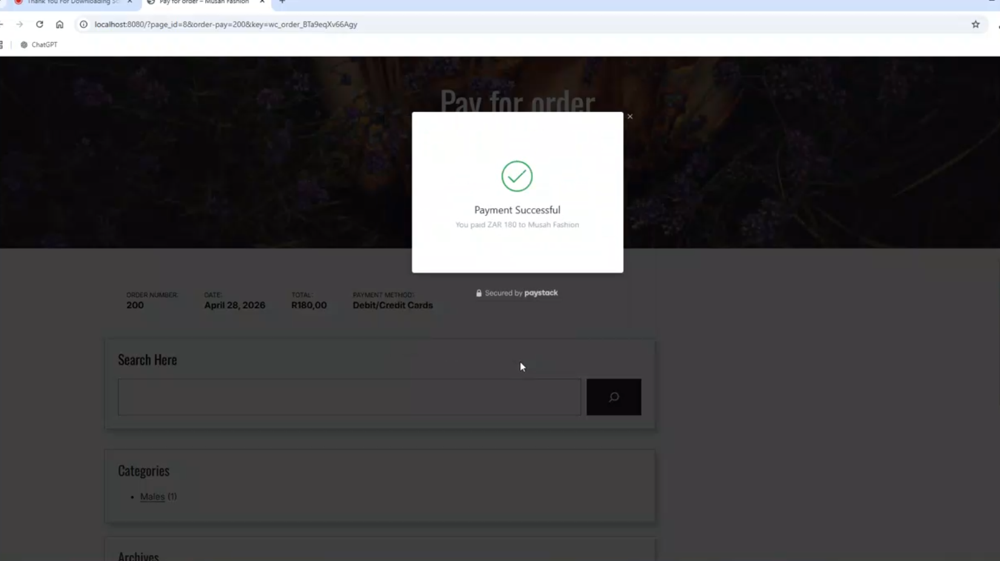
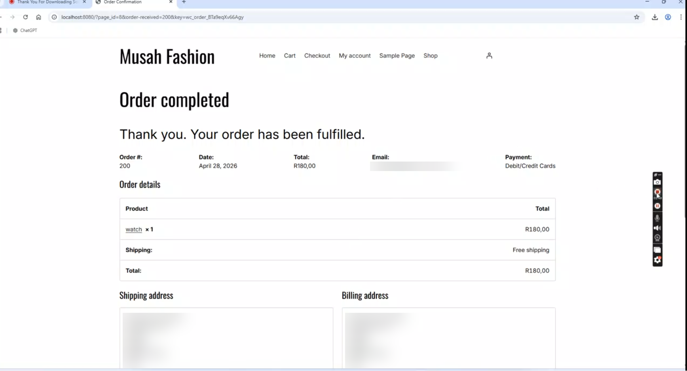

#  Musah Fashion: E-Commerce Website (WordPress + WooCommerce on Docker)

An individual full-stack e-commerce project for a fashion accessories store (watches, sunglasses, bracelets and necklaces). The shop runs on **WordPress with WooCommerce**, is **containerised with Docker**, and supports the complete customer journey from browsing products to paying online and receiving an order confirmation.

>  **Module:** ISTN3EC (E-Commerce) · University of KwaZulu-Natal · Semester 1, 2026
>  **Type:** Individual project · **Developer:** Bongumusa Seluleko Gumede

---

##  Demo video

 **[Watch the full walkthrough here](ADD-YOUR-VIDEO-LINK-HERE)**

The video shows the full flow end to end: browsing, adding to cart, checkout and payment.

---

##  Key features

- **Product catalogue** with 23 products, sale badges (original price struck through) and pagination
- **Product categories and brand** (e.g. Males, Unisex, Brand: Musah Fashion)
- **Product detail pages** with description, price, quantity selector and add-to-cart
- **Shopping cart** with quantity updates, coupon support, and cart totals
- **Shipping setup** for South African customers (free shipping to KwaZulu-Natal)
- **Checkout** with billing and shipping details (Country, Province, Postcode)
- **Multiple payment methods:** debit/credit cards (Paystack), MustangPay, direct bank transfer, cash on delivery
- **Order confirmation** page with order number, date, total and payment method
- **Sidebar widgets:** search, categories, archives, pages and social media links
- **Fully containerised** so the whole shop can be started with a single command

---

##  Tech stack

| Layer | Technology |
|---|---|
| CMS / Platform | WordPress |
| E-commerce engine | WooCommerce |
| Payments | Paystack (cards), MustangPay, EFT, cash on delivery |
| Database | MySQL |
| Containerisation | Docker & Docker Compose |
| Frontend | HTML5, CSS3, PHP (WordPress theme layer) |
| Currency / locale | South African Rand (ZAR), South Africa |

---

##  Docker skills demonstrated

This project shows practical, hands-on experience with:

- Running **WordPress and MySQL as separate containers** and connecting them over a Docker network
- Writing a **`docker-compose.yml`** to define multi-container applications
- **Port mapping** (host port `8080` → container port `80`)
- **Volumes** for persisting the database and WordPress files (`wp-content`)
- Managing **environment variables** for database credentials and configuration
- Using **official images** from Docker Hub
- Container lifecycle commands: `up`, `down`, `ps`, `logs`, `exec`, `restart`
- Reproducible, portable environments: "works on my machine" becomes "works on every machine"
- Basic **troubleshooting** of containers (checking logs, resolving port conflicts, database connection errors)
- Understanding of Docker Desktop with WSL 2 on Windows

---

##  Screenshots




















---

##  Getting started (run it locally)

### Prerequisites
- [Docker Desktop](https://www.docker.com/products/docker-desktop/) (with WSL 2 on Windows)
- Git

### Steps

```bash
# 1. Clone the repository
git clone https://github.com/musahhh4/REPO-NAME.git
cd REPO-NAME

# 2. Create your environment file and set your own passwords
cp .env.example .env

# 3. Start the containers
docker compose up -d

# 4. Open the site
# http://localhost:8080
```

On first launch, WordPress will ask you to complete the setup wizard. Then install and activate WooCommerce and configure the store (see **[docs/DOCUMENTATION.md](docs/DOCUMENTATION.md)** for the full setup guide).

### Useful commands

```bash
docker compose ps            # check running containers
docker compose logs -f       # follow logs
docker compose down          # stop containers (data is kept in volumes)
docker compose down -v       # stop and delete volumes (resets everything)
```

---

##  Documentation

Full project documentation (requirements, architecture, Docker deployment, configuration, testing and future improvements) is in **[docs/DOCUMENTATION.md](docs/DOCUMENTATION.md)**.

---

##  Security note

No real credentials are stored in this repository. Passwords and API keys (including Paystack keys) must be supplied through a local `.env` file, which is excluded by `.gitignore`. Payments in this project were demonstrated in a development environment.

---

##  Future improvements

- Deploy to a cloud host (e.g. Azure App Service for Containers) with HTTPS
- Add customer reviews and product ratings
- Add email notifications for order status changes
- Add stock-level alerts and an admin sales dashboard
- Add a CI/CD pipeline to build and deploy the containers automatically

---

##  Author

**Bongumusa Seluleko Gumede**
BCom Information Systems & Technology, University of KwaZulu-Natal
 [LinkedIn](https://www.linkedin.com/in/bongumusagumede/) ·  [GitHub](https://github.com/musahhh4)
