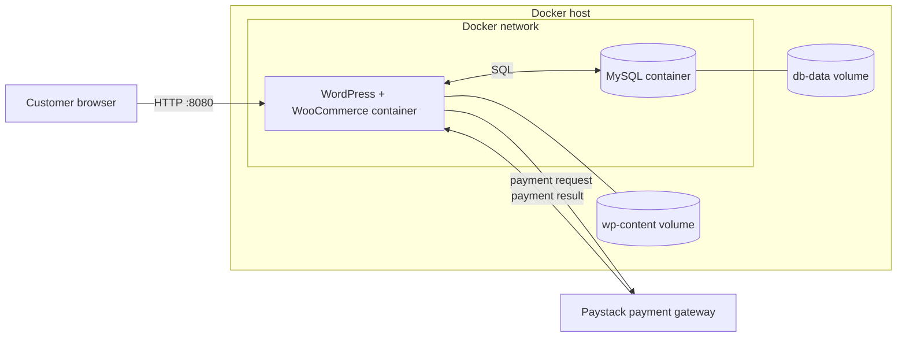
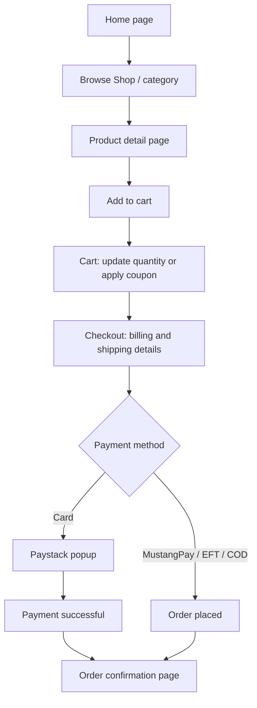

# Musah Fashion E-Commerce Website: Project Documentation

| | |
|---|---|
| **Project name** | Musah Fashion E-Commerce Website |
| **Module** | ISTN3EC (E-Commerce) |
| **Institution** | University of KwaZulu-Natal |
| **Period** | Semester 1, 2026 |
| **Project type** | Individual |
| **Developer** | Bongumusa Seluleko Gumede |
| **Platform** | WordPress + WooCommerce, deployed with Docker |

---

## Table of contents

1. [Introduction](#1-introduction)
2. [Objectives](#2-objectives)
3. [Scope](#3-scope)
4. [Requirements](#4-requirements)
5. [System architecture](#5-system-architecture)
6. [Technology stack](#6-technology-stack)
7. [Docker deployment](#7-docker-deployment)
8. [Store configuration](#8-store-configuration)
9. [User journey](#9-user-journey)
10. [Testing](#10-testing)
11. [Security considerations](#11-security-considerations)
12. [Challenges and lessons learned](#12-challenges-and-lessons-learned)
13. [Limitations and future improvements](#13-limitations-and-future-improvements)
14. [Appendix: Docker troubleshooting](#14-appendix-docker-troubleshooting)

---

## 1. Introduction

**Musah Fashion** is an online store for fashion accessories, including watches, sunglasses, bracelets and necklaces. It was built as an individual project for the E-Commerce module (ISTN3EC). The goal was to design, build and deploy a working e-commerce website that lets a customer browse products, add them to a cart, check out and pay online.

The shop is built on **WordPress** using the **WooCommerce** plugin and is deployed in **Docker containers**, which makes the environment portable, repeatable and easy to start on any machine that has Docker installed.

## 2. Objectives

- Build a functional online store with a product catalogue, cart, checkout and payment.
- Support payment methods relevant to the South African market.
- Deploy the application using **Docker** so that it is portable and easy to reproduce.
- Provide a clean, user-friendly shopping experience on desktop and mobile.
- Apply e-commerce concepts learned in the module (catalogue management, pricing and promotions, shipping, payments, order management).

## 3. Scope

**In scope**
- Product catalogue with categories, brand, sale pricing and pagination
- Product detail pages
- Shopping cart with coupon support
- Checkout with billing and shipping details
- Online payment via Paystack, plus MustangPay, EFT and cash on delivery
- Order confirmation
- Containerised deployment on a local Docker host

**Out of scope (for this version)**
- Production hosting on a public domain with HTTPS
- Customer reviews moderation workflow
- Inventory forecasting and advanced analytics
- Native mobile application

## 4. Requirements

### 4.1 Functional requirements

| ID | Requirement |
|---|---|
| FR1 | The system shall display a home page with a hero banner and featured categories. |
| FR2 | The system shall list all products with image, name, price and sale badge. |
| FR3 | The system shall paginate the product list and allow sorting. |
| FR4 | The system shall show a detail page for each product with description, category and brand. |
| FR5 | A customer shall be able to add products to a cart, change quantities and remove items. |
| FR6 | A customer shall be able to apply a coupon code in the cart. |
| FR7 | The system shall calculate subtotal, shipping and total automatically. |
| FR8 | A customer shall be able to enter billing and shipping details at checkout. |
| FR9 | The system shall offer multiple payment methods (cards, MustangPay, bank transfer, cash on delivery). |
| FR10 | The system shall process card payments securely through Paystack. |
| FR11 | The system shall show an order confirmation with order number, date, total and payment method. |
| FR12 | The system shall provide search, category and archive navigation through sidebar widgets. |

### 4.2 Non-functional requirements

| ID | Requirement |
|---|---|
| NFR1 | **Portability:** the full environment must start with a single `docker compose up` command. |
| NFR2 | **Usability:** the shopping flow must be simple and clear, with a maximum of a few steps from product to payment. |
| NFR3 | **Security:** payments are handled by a PCI-compliant gateway; no card data is stored on the shop server. |
| NFR4 | **Persistence:** database and uploaded files must survive container restarts (Docker volumes). |
| NFR5 | **Maintainability:** configuration is kept in environment variables and a compose file, not hard-coded. |
| NFR6 | **Localisation:** prices are shown in South African Rand (ZAR) with South African provinces at checkout. |

## 5. System architecture

The system follows a simple multi-container architecture. The customer's browser talks to the WordPress container on port 8080. WordPress (with WooCommerce) reads and writes data in the MySQL container, and card payments are handed off to Paystack's hosted payment popup.



**Request flow**
1. The customer opens `http://localhost:8080`; Docker forwards the request from host port 8080 to port 80 in the WordPress container.
2. WordPress and WooCommerce render pages using product and order data stored in MySQL.
3. At checkout, the order is created in the database with a pending status.
4. For card payments, the Paystack popup collects and processes payment, then returns the result to the shop.
5. WooCommerce marks the order as paid and displays the order confirmation.

## 6. Technology stack

| Component | Technology | Purpose |
|---|---|---|
| Web platform | WordPress | Content management and theming |
| E-commerce engine | WooCommerce | Products, cart, checkout, orders |
| Payment gateways | Paystack, MustangPay, EFT, cash on delivery | Customer payments |
| Database | MySQL | Persistent storage of products, orders, customers |
| Containers | Docker, Docker Compose | Packaging and orchestration |
| Languages | PHP, HTML5, CSS3, SQL | WordPress core, theme and queries |
| Locale | ZAR currency, South Africa | Pricing and addresses |

## 7. Docker deployment

### 7.1 Why Docker?

- **Consistency:** the same environment runs on a laptop, a lab computer or a server.
- **Isolation:** WordPress and MySQL run in separate containers and do not interfere with the host.
- **Speed:** the whole stack starts in one command.
- **Reproducibility:** configuration is code (`docker-compose.yml`), so it can be versioned in Git.

### 7.2 Prerequisites

- Docker Desktop (with WSL 2 on Windows) or Docker Engine and Docker Compose on Linux
- Git
- Free port **8080** on the host

### 7.3 Project structure

```
musah-fashion-ecommerce/
├── docker-compose.yml     # defines the WordPress and MySQL services
├── .env.example           # template for credentials (copy to .env)
├── .gitignore             # keeps .env and local data out of Git
├── README.md
├── docs/
│   └── DOCUMENTATION.md   # this document
└── screenshots/           # images used in the README
```

### 7.4 Compose file

> Adjust image versions, ports and names so they match what you actually used.

```yaml
services:
  db:
    image: mysql:8.0
    container_name: musah_db
    restart: unless-stopped
    environment:
      MYSQL_DATABASE: ${DB_NAME}
      MYSQL_USER: ${DB_USER}
      MYSQL_PASSWORD: ${DB_PASSWORD}
      MYSQL_ROOT_PASSWORD: ${DB_ROOT_PASSWORD}
    volumes:
      - db-data:/var/lib/mysql

  wordpress:
    image: wordpress:latest
    container_name: musah_wordpress
    depends_on:
      - db
    restart: unless-stopped
    ports:
      - "8080:80"
    environment:
      WORDPRESS_DB_HOST: db:3306
      WORDPRESS_DB_NAME: ${DB_NAME}
      WORDPRESS_DB_USER: ${DB_USER}
      WORDPRESS_DB_PASSWORD: ${DB_PASSWORD}
    volumes:
      - wp-content:/var/www/html/wp-content

volumes:
  db-data:
  wp-content:
```

### 7.5 Environment file

Copy `.env.example` to `.env` and choose your own strong passwords. **Never commit `.env`.**

```env
DB_NAME=musah_fashion
DB_USER=wp_user
DB_PASSWORD=change_me
DB_ROOT_PASSWORD=change_me_too
```

### 7.6 Deployment steps

```bash
# 1. Clone the repository
git clone https://github.com/musahhh4/REPO-NAME.git
cd REPO-NAME

# 2. Create the environment file
cp .env.example .env
# edit .env and set your own passwords

# 3. Start the stack in the background
docker compose up -d

# 4. Verify that both containers are running
docker compose ps

# 5. Open the site
# http://localhost:8080
```

### 7.7 Day-to-day commands

| Task | Command |
|---|---|
| Check running containers | `docker compose ps` |
| View live logs | `docker compose logs -f wordpress` |
| Stop (keep data) | `docker compose down` |
| Stop and delete all data | `docker compose down -v` |
| Restart one service | `docker compose restart wordpress` |
| Open a shell in WordPress | `docker compose exec wordpress bash` |
| Back up the database | `docker compose exec db mysqldump -u root -p musah_fashion > backup.sql` |

## 8. Store configuration

After the containers are running, the store is configured through the WordPress admin dashboard (`http://localhost:8080/wp-admin`).

### 8.1 WordPress setup
1. Complete the installation wizard (site title **Musah Fashion**, admin account, email).
2. Choose a theme and set up the **navigation menu** (Home, Cart, Checkout, My account, Sample Page, Shop).
3. Add **sidebar widgets**: Search, Categories, Archives, Pages, Social Media.

### 8.2 WooCommerce setup
1. Install and activate **WooCommerce** and run its setup wizard.
2. Set the store currency to **South African Rand (ZAR)** and the country to **South Africa**.
3. Create the **Cart**, **Checkout** and **My account** pages (WooCommerce creates these automatically).

### 8.3 Products
1. Create **categories** (e.g. Males, Unisex) and a **Brand** (Musah Fashion).
2. Add products with name, image, regular price and **sale price** (the sale badge and struck-through price appear automatically).
3. Add a short description and a full description for each product.
4. The catalogue contains **23 products** across two pages.

### 8.4 Shipping
1. Create a shipping zone for **South Africa / KwaZulu-Natal**.
2. Add a **Free shipping** method to the zone.

### 8.5 Payments
1. Enable **Debit/Credit Cards** through the **Paystack** gateway (add API keys in the gateway settings, never in Git).
2. Enable **MustangPay**, **Direct bank transfer** and **Cash on delivery**.

### 8.6 Home page
1. Add a hero banner with the message **"Luxury You Deserve"**.
2. Add the **"Best For You"** category carousel (Bracelets, Sunglasses, Necklace).

## 9. User journey



| Step | Page | What the customer does | Screenshot |
|---|---|---|---|
| 1 | Home | Sees the hero banner and "Best For You" categories | `01`, `02` |
| 2 | Shop | Browses products and sale prices across pages | `03`, `04` |
| 3 | Product | Reads the description, selects quantity | `05` |
| 4 | Cart | Reviews items, updates quantity, applies coupon | `06` |
| 5 | Checkout | Enters billing/shipping details | `07` |
| 6 | Payment | Selects payment method and reviews the order | `08` |
| 7 | Paystack | Pays securely and sees the success message | `09` |
| 8 | Confirmation | Sees order number, details and addresses | `10` |

## 10. Testing

Functional testing was performed manually against the running Docker deployment. The test scenarios below correspond to the behaviour shown in the screenshots and the demo video.

| ID | Scenario | Steps | Expected result | Result |
|---|---|---|---|---|
| T1 | Home page loads | Open `http://localhost:8080` | Hero banner and navigation shown | Pass |
| T2 | Category carousel | Scroll the "Best For You" section | Categories displayed | Pass |
| T3 | Product listing | Open Shop | Products shown with prices and sale badges | Pass |
| T4 | Pagination | Go to page 2 | "Showing 17–23 of 23 results" | Pass |
| T5 | Product detail | Open a product | Image, price, description, category and brand shown | Pass |
| T6 | Add to cart | Click **Add to cart** | Product appears in the cart with the correct price | Pass |
| T7 | Cart totals | View cart with one R180,00 item | Subtotal R180,00, free shipping, total R180,00 | Pass |
| T8 | Checkout form | Open Checkout | Required fields marked, Province and Country preselected | Pass |
| T9 | Order summary | Fill in details | Order table shows product, subtotal, shipping, total | Pass |
| T10 | Card payment | Choose Debit/Credit Cards and pay | Paystack shows "Payment Successful" | Pass |
| T11 | Order confirmation | Complete payment | "Order completed" page with order #200 | Pass |
| T12 | Data persistence | `docker compose down` then `up -d` | Products and orders are still present | Add your own result |
| T13 | Responsive layout | Open on a phone-sized window | Layout adapts, menu remains usable | Add your own result |

> Complete T12, T13 and any extra negative tests yourself (e.g. empty required fields at checkout, invalid coupon, remove item from cart) and record the real result.

## 11. Security considerations

- **Payments:** card details are entered into Paystack's secure popup; the shop never stores card data.
- **Secrets:** database passwords and gateway API keys are kept in `.env` (excluded by `.gitignore`), never in the repository.
- **Containers:** MySQL is not exposed to the host (no published port), so it is reachable only from the WordPress container.
- **Updates:** keep WordPress, WooCommerce, plugins and Docker images updated.
- **Admin access:** use a strong admin password; consider limiting login attempts and enabling two-factor authentication on a public deployment.
- **Production:** serve the site over **HTTPS** and use live (not test) gateway keys only on a properly secured server.
- **Personal data:** screenshots in this repository have had customer email and address details blurred.

## 12. Challenges and lessons learned

> Replace or extend these with your own real experiences; they should sound like your project, not a template.

- **Container networking:** WordPress must reach the database by its service name (`db`), not `localhost`, from inside the container.
- **Data persistence:** without volumes, products and orders are lost when containers are removed, so named volumes are essential.
- **Payment integration:** configuring the payment gateway requires careful handling of API keys and understanding of test versus live modes.
- **Localisation:** configuring ZAR currency, provinces and shipping zones is necessary for a realistic South African store.
- **Deployment mindset:** treating infrastructure as code (compose file plus `.env`) makes the project far easier to hand over and reproduce.

## 13. Limitations and future improvements

**Current limitations**
- Runs locally; not yet hosted on a public domain with HTTPS.
- Orders are processed manually (no automated fulfilment or courier integration).
- Basic reporting only.

**Future improvements**
- Deploy to the cloud (e.g. Azure App Service for Containers) with a custom domain and HTTPS
- Add a CI/CD pipeline (GitHub Actions) to build and deploy automatically
- Email and SMS order-status notifications
- Customer reviews, wishlists and product recommendations
- Stock alerts and a sales analytics dashboard
- Automated database backups
- Courier integration for live shipping rates and tracking

## 14. Appendix: Docker troubleshooting

| Problem | Likely cause | Fix |
|---|---|---|
| `port is already allocated` | Another app uses port 8080 | Change the left side of the mapping, e.g. `"8081:80"` |
| "Error establishing a database connection" | Database not ready yet or wrong credentials | Wait a few seconds, check `.env`, run `docker compose logs db` |
| Site shows setup wizard again | Volumes were deleted | Avoid `docker compose down -v` unless you want a reset |
| Changes to `.env` not applied | Containers were not recreated | Run `docker compose up -d --force-recreate` |
| Uploads fail or are slow | File permissions or low disk space | Check `docker compose logs wordpress` and free disk space |
| Docker will not start on Windows | WSL 2 or virtualisation not enabled | Enable WSL 2 and virtualisation in BIOS, then restart Docker Desktop |

---

*Document version 1.0 · Author: Bongumusa Seluleko Gumede*
